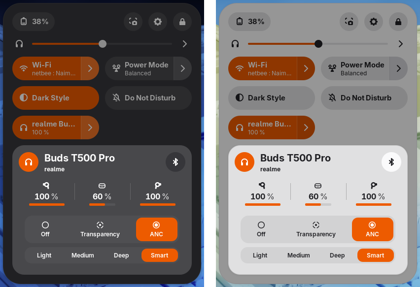

# Earshot

A GNOME Shell extension that puts your Bluetooth headphones in the quick
settings: the battery of each earbud and of the charging case, and a switch
for noise control. Nothing is added to the top panel.

<p align="center">
  
  
</p>

<p align="center">
  
</p>

## What it shows

The menu shows only what your headphones actually report, so it changes
with the model:

- **The tile**, while headphones are connected: their name and battery. A tap
  opens the menu; the tile is lit while noise cancelling is on.
- **The menu's header**: the model, with its maker under it when the name or
  protocol gives it away, and a Bluetooth button in the corner that opens
  Bluetooth Settings.
- **Left and right earbuds**, each in a column of its own: the bud's glyph over
  its level, and a bar under them. A bar glows while its part is charging, and
  turns red at 20 % or below. Over-ear headphones get one level instead.
- **The case**, in a column between the buds with a shorter bar, when the buds
  report it. The case only
  reports while it is open; once you close it you see the last level it
  reported, dimmed, captioned "Last seen". A case that has never reported is
  not shown.
- **Noise control**, when the headphones let it be changed: the modes they
  have, from Off, Transparency, ANC, Adaptive, Wind (Sony and Bose), and
  Immersion and Cinema (Bose Ultra), plus noise cancelling's levels where they
  offer them. Some earbuds only change mode while you wear them; the menu says
  so when they are out of your ears.

- **Connections**, for realme, OnePlus and OPPO buds linked to two or three
  devices at once: this computer and the others the buds are connected to.
  Buds whose firmware takes it get a Disconnect button for each other device,
  and Connect for the ones they remember; the rest only show the list (the
  realme Buds T500 Pro is one of these).

If more than one pair is connected, the menu lists them to pick from.

## Supported headphones

| Brand | What you get |
|---|---|
| realme, OnePlus, OPPO | Battery of each bud and the case. Noise control and its levels on the 64 models in [`src/backends/oppoModels.js`](src/backends/oppoModels.js), such as the realme Buds T500 Pro and Air7, OnePlus Buds 3 and OPPO Enco X3. |
| Sony | Battery of the headphones, or of each bud and the case. Off, Transparency (ambient sound), ANC, and Wind where the model has it. |
| Samsung Galaxy Buds | Battery of each bud and the case. Ambient sound on the Buds and Buds+, ANC on the Buds Live, and Off, Transparency and ANC on the Buds Pro and later. |
| AirPods and Beats | Battery of each bud and the case, or of AirPods Max. Off, Transparency and ANC on the models with noise control, and Adaptive on the AirPods Pro 2 and AirPods 4 with ANC. |
| Bose | Battery of the headphones, or of each bud and the case. Quiet and Aware (and Immersion and Cinema on the Ultra models), or Off, Low, High and Wind on the QuietComfort 35. |
| Nothing, CMF | Battery of each bud and the case. Off, Transparency, ANC with the levels the model reports, and Adaptive where it has it. |
| Xiaomi, Redmi | Battery of each bud and the case. Off, Transparency and ANC, and its strength where the model has one. |
| Soundcore (Anker) | Battery of each bud and the case. Off, Transparency and ANC. |
| Everything else: JBL, QCY, SoundPEATS, Jabra, Sennheiser, Edifier, Hoco, Lenovo, Oraimo, Joyroom, Ugreen, Moondrop and the rest | The one battery level the headphones report to the system, if they report one. No noise control or case: these brands use private app protocols that are not documented. |

Only the realme Buds T500 Pro has been tested with real hardware. The other
brands follow published reverse engineering (see Credits) and are covered by
the protocol tests, but have not been tried on their headphones.

Headphones show up when they connect, whatever they call themselves: by
headphone or headset type, by a protocol the extension knows, or by offering a
headset profile and a battery level, as many budget earbuds that claim to be
speakers do.

## Install

Needs GNOME Shell 47 to 51 and BlueZ, which every GNOME desktop already has.
No other packages, and no root access.

```sh
make install
```

Log out and back in (on Wayland the shell only finds new extensions at login),
then:

```sh
make enable
```

To remove it: `make uninstall`.

## How it works

Headphones with a companion app talk to it over a control channel next to
the audio, each brand with its own protocol. The extension recognises the
brand by the services the headphones offer, registers a client profile for
that brand's channel with BlueZ over D-Bus, asks BlueZ to connect it, and gets
the open socket back; no root access is needed. It then asks for the battery
levels and noise control mode, and the headphones announce changes as they
happen. It reads everything again each time you open the quick settings,
because some models do not announce every change.

The menu is built from what comes back: a part with no level is not shown,
and noise control appears only once the headphones report a mode. Headphones
that do not answer keep working normally and show the battery level BlueZ
has, which most headphones report through the hands-free profile.

## Development

| Command | What it does |
|---|---|
| `make check` | Syntax-checks every module. |
| `make test` | Runs the protocol tests against frames captured from real earbuds; needs no shell or Bluetooth. |
| `make pack` | Builds the zip to upload to extensions.gnome.org. |
| `make shexli` | Runs the extensions.gnome.org review checks on that zip. |
| `make logs` | Follows the extension's messages in the shell's log. |

| File | Role |
|---|---|
| `src/extension.js` | Adds and removes the quick settings tile. |
| `src/quickToggle.js` | The tile and its menu. |
| `src/headphones.js` | Which headphones are connected, and their control channels. |
| `src/session.js` | One open control channel: socket, send queue, shared state. |
| `src/noise.js` | The noise control modes and levels every brand reports in. |
| `src/brands.js` | The maker and model, from the name the headphones go by. |
| `src/bluez.js` | BlueZ's devices and calls into BlueZ. |
| `src/profile.js` | The BlueZ profile that receives a control channel. |
| `src/backends/` | One file per brand, and `index.js`, which picks one for a device. |

To add a brand, write a backend in the shape `index.js` describes, add it to
the list there, and add its frames to `tests/backends.test.js`.

## Credits

The protocols follow published reverse engineering:
[Gadgetbridge](https://codeberg.org/Freeyourgadget/Gadgetbridge) (OPPO, Sony,
Nothing, Xiaomi, Soundcore),
[QuickBuds](https://github.com/spizganed/QuickBuds) (OPPO; the per-model noise
control table is generated from its model catalog),
[GalaxyBudsClient](https://github.com/timschneeb/GalaxyBudsClient) (Samsung),
[LibrePods](https://github.com/kavishdevar/librepods) (AirPods) and
[bosectl](https://github.com/aaronsb/bosectl) (Bose).

## License

GPL-3.0-or-later. See [LICENSE](LICENSE).
